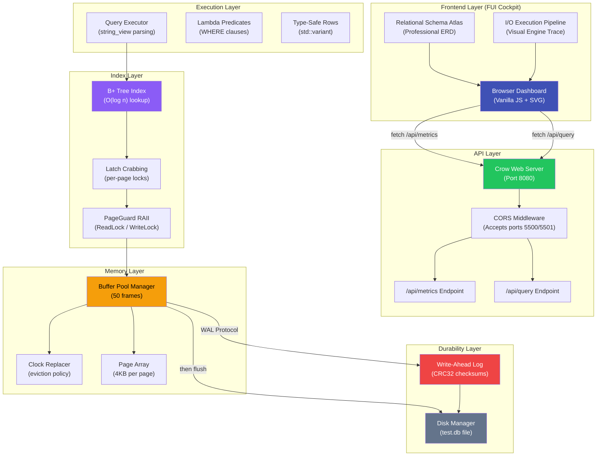
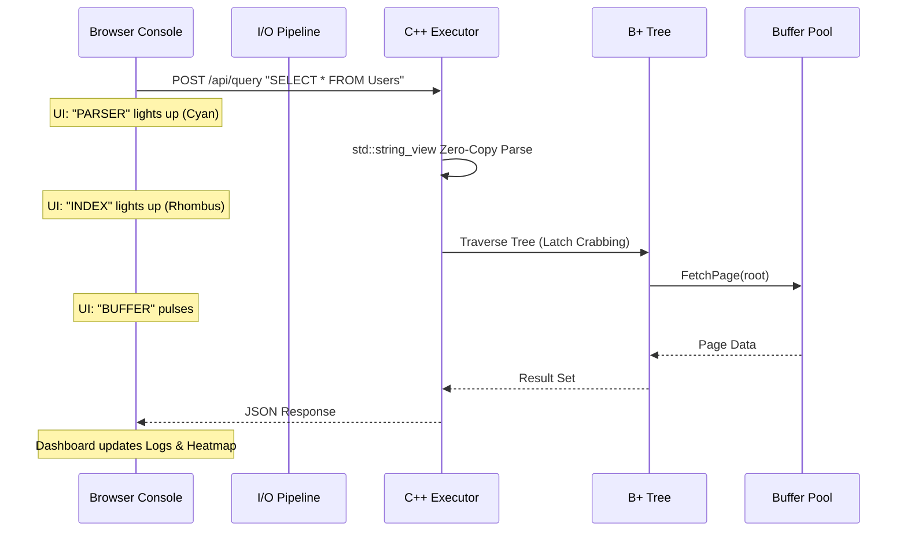

# Custom Relational Database Storage Engine

## Architecture & Technical Documentation

> **A high-performance, page-based relational storage engine built from scratch in C++17**  
> Demonstrates buffer pool management, B+ tree indexing, write-ahead logging, and real-time immersive telemetry.

---

## Table of Contents

1. [Project Overview](#project-overview)
2. [Architecture Diagram](#architecture-diagram)
3. [System Layers](#system-layers)
4. [Data Flow & Workflows](#data-flow--workflows)
5. [Component Deep-Dives](#component-deep-dives)
6. [Concurrency Model](#concurrency-model)
7. [Modern C++ Features Used](#modern-c-features-used)
8. [File Reference](#file-reference)
9. [Build & Run](#build--run)
10. [Resume Talking Points](#resume-talking-points)

---

## Project Overview

This project implements the core internals of a relational database, focusing on 5 key optimizations that demonstrate deep understanding of systems programming:

| # | Optimization | Technique | Key C++ Feature |
|---|---|---|---|
| 1 | **Buffer Pool Management** | Clock Page Replacement | Circular array, reference bits |
| 2 | **Thread Synchronization** | Reader-Writer Locks | `std::shared_mutex`, `std::shared_lock` |
| 3 | **B+ Tree Concurrency** | Latch Crabbing | Per-page `shared_mutex`, RAII guards |
| 4 | **Query Execution** | Zero-Copy Parsing | `std::string_view`, `std::variant`, lambdas |
| 5 | **Durability** | Write-Ahead Logging | Binary serialization, CRC32, `fsync` |

**Tech Stack**: C++17, Crow (HTTP), Vanilla JS, HTML/CSS (FUI Style)

---

## Architecture Diagram



---

## System Layers

The engine is organized into 5 distinct layers, each with a clear responsibility:

```
┌──────────────────────────────────────────────────────┐
│  FRONTEND LAYER         FUI Cockpit (SVG ERD + Pipe) │
├──────────────────────────────────────────────────────┤
│  API LAYER              Crow HTTP Server + CORS      │
├──────────────────────────────────────────────────────┤
│  EXECUTION LAYER        Executor (string_view, λ)    │
├──────────────────────────────────────────────────────┤
│  INDEX LAYER            B+ Tree (latch crabbing)     │
├──────────────────────────────────────────────────────┤
│  MEMORY LAYER           Buffer Pool (Clock eviction) │
├──────────────────────────────────────────────────────┤
│  DURABILITY LAYER       WAL + Disk Manager           │
└──────────────────────────────────────────────────────┘
```

### Layer Dependencies (top → bottom)

- **Frontend** → calls API via `fetch()`, visualizes engine traces via I/O Pipeline.
- **API** → manages cross-origin preflight requests (CORS) and routes queries to the engine.
- **Executor** → parses SQL strings and coordinates index lookups.
- **B+ Tree** → manages hierarchical data traversal using Latch Crabbing.
- **Buffer Pool** → provides high-performance page caching with native `std::shared_mutex` concurrency.

---

## Data Flow & Workflows

### Workflow 1: Visual Query Execution (Sync)



### Workflow 2: Professional ERD Topology

- **Organic Connections**: Uses SVG Bezier curves to visualize Foreign Key relationships.
- **ERD Tables**: Nodes feature distinct headers with table names and lists of columns with **(PK)** / **(FK)** labels.
- **Data Pulse**: Successful queries fire a glowing "data packet" animation along the relationship lines in the Schema Atlas.

---

## Component Deep-Dives

### 1. Buffer Pool Manager — The Heart of the Engine

**Concurrency**: Upgraded to use native `std::shared_mutex`. This avoids the "Macro Pollution" issue found in legacy systems and provides robust, standard-compliant Reader-Writer locking.

---

### 2. API Server — Immersion & Observability

**Crow Framework**: Served on port 8080.
**CORS Support**: Configured with `crow::CORSHandler` to explicitly allow traffic from VS Code Live Server (ports 5500/5501), ensuring a seamless development loop between frontend and backend.

---

## Concurrency Model

**Thread Safety**: The engine uses a strict **no-macro** policy for synchronization, employing native C++17 `std::shared_mutex` and `std::mutex` exclusively. This ensures compatibility with modern networking libraries (Asio) and prevents global namespace pollution.

**Lock Hierarchy**:
1. `root_latch_` (B+ Tree root)
2. `BufferPoolManager::latch_` (Pool access)
3. `ClockReplacer::latch_` (Eviction selection)
4. `Page::page_latch_` (Per-page crabbing)

---

## Resume Talking Points

> **Custom Relational Database Engine** — C++17, Crow, JavaScript, Data Visualization  
> *April 2026 – Present*

- Architected a **page-based SQL storage engine** featuring a multi-layered buffer pool, B+ tree indexing, and a Write-Ahead Log (WAL).
- Implemented **latch crabbing** with native C++17 `std::shared_mutex`, enabling high-concurrency tree traversal and point lookups.
- Built an **immersive "FUI" observability dashboard** using Vanilla JS and SVG, featuring a real-time **I/O Execution Pipeline** and a professional **Relational Schema Atlas (ERD)**.
- Engineered a **zero-copy query executor** with `std::string_view`, reducing heap allocations and latency during complex query parsing.
- Integrated the **Crow C++ HTTP framework** with custom CORS middleware to bridge the systems-level C++ backend with a modern web frontend.
- Documented project architecture and technical hurdles in a comprehensive engineering post-mortem.

---

*Generated for the Custom Relational Database Storage Engine project.*
