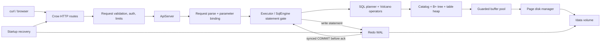

# CUSTOM-DB

[](https://github.com/Aditya-Deshwal23/CUSTOM-DB/actions/workflows/ci.yml)
[](LICENSE)
[](https://github.com/Aditya-Deshwal23/CUSTOM-DB/actions/workflows/ci.yml)

CUSTOM-DB is a small C++17 relational storage engine presented as one self-contained service: Crow serves a versioned SQL API and a vanilla HTML/CSS/JavaScript dashboard, while a page-oriented buffer pool, B+ tree, single-page SQL catalog, and checksummed redo WAL provide an inspectable persistence path from statement to disk. It is an engineering project for learning and demonstration—not a general-purpose or production database—and its measured trade-offs and unsupported features are documented below.

## Live demo

Try the [live dashboard](https://custom-db-engine.onrender.com). It runs on Render's Free tier: its local filesystem is ephemeral and the service spins down when idle, so data may reset. Do not use the demo for persistent data. Persistent disks require a paid Render instance; see Render's [Free instance](https://render.com/docs/free) and [disk](https://render.com/docs/disks) documentation.

## 60-second quickstart

Requires Docker and `curl`. The published v1.0.0 image is multi-architecture and stores database files in the named volume:

```sh
docker volume create custom-db-data
docker run -d --name custom-db -p 8080:8080 \
  -e PORT=8080 -e DB_PATH=/data/custom.db \
  --mount source=custom-db-data,target=/data \
  ghcr.io/aditya-deshwal23/custom-db:1.0.0
curl -fsS http://localhost:8080/readyz
curl -fsS -X POST http://localhost:8080/api/v1/query \
  -H 'Content-Type: application/json' \
  -d '{"sql":"CREATE TABLE quickstart (id INT PRIMARY KEY, value INT)"}'
curl -fsS -X POST http://localhost:8080/api/v1/query \
  -H 'Content-Type: application/json' \
  -d '{"sql":"INSERT INTO quickstart VALUES (1, 42)"}'
curl -fsS -X POST http://localhost:8080/api/v1/query \
  -H 'Content-Type: application/json' \
  -d '{"sql":"SELECT id, value FROM quickstart"}'
docker stop custom-db
docker rm custom-db
```

CI runs the same container workflow through [`scripts/quickstart.sh`](scripts/quickstart.sh) against the image it just built. For a local source build, use the [development instructions](RUN_INSTRUCTIONS.md).

## What works today

| Area | Implemented | Limits | Not implemented |
|---|---|---|---|
| Storage and indexes | ✓ [storage tests](tests/storage_test.cpp), [B+ tree tests](tests/b_plus_tree_test.cpp) | One process-local database; tuple max 4,067 bytes | Overflow pages; replication |
| SQL | ✓ [SQL execution tests](tests/sql_execution_test.cpp), [parser tests](tests/sql_parser_test.cpp) | Deliberate SQL subset; see [reference](docs/SQL_REFERENCE.md) | Joins; general SQL; multi-statement transactions |
| Recovery | ✓ [WAL tests](tests/regression/known_bugs_test.cpp), [Linux crash workflow](.github/workflows/ci.yml) | Full-page after-image WAL can amplify writes | MVCC; distributed recovery |
| Concurrency | ✓ [writer fairness test](tests/sql_execution_test.cpp), [TSan stress](.github/workflows/ci.yml) | Multiple readers, one writer, statement-level serialization | Concurrent writers; snapshot isolation |
| Planner and execution | ✓ [plan/execution tests](tests/sql_execution_test.cpp), [SQL benchmarks](docs/BENCHMARKS.md) | Sort and grouping use memory; one-page catalog | Cost-based optimizer; spill-to-disk operators |
| HTTP service | ✓ [API contract tests](tests/api/test_api.py), [OpenAPI](docs/openapi.yaml) | One service; bounded API and statement settings | Replication protocol; clustering |
| Dashboard | ✓ [browser tests](tests/dashboard/test_dashboard.py) | Same-origin, live data; replay is explicitly labeled | Offline editing or fake live telemetry |
| Packaging | ✓ [container CI](.github/workflows/ci.yml), [crash demo](scripts/demo_crash.sh) | Render Free storage is ephemeral | Persistent storage on Render Free |

More detail and evidence links live in the [claim ledger](docs/CLAIMS.md) and [limitations](docs/LIMITATIONS.md).

## Architecture



The diagram reflects the [runtime wiring](src/main.cpp), [API routes](src/api/routes.cpp), [executor](src/executor.cpp), and [SQL planner/operators](src/sql_executor.cpp). Recovery completes before the HTTP server starts.

## Life of a statement

1. Crow receives `POST /api/v1/query`; middleware assigns a request ID and enforces request, authentication, rate, and body limits.
2. The API validates the JSON contract and binds parameters. The SQL lexer/parser creates a positioned statement AST.
3. The SQL executor resolves catalog metadata, builds the selected access path/operator pipeline, and checks cooperative cancellation and row limits.
4. Operators read through page guards into the buffer pool, using the B+ tree for supported key lookups/ranges or a table scan otherwise.
5. A write statement owns the exclusive statement gate and one WAL transaction. Before-images support rollback; committed page after-images plus COMMIT are appended and synced before the statement can be acknowledged.
6. The API serializes typed rows or a structured error. Checkpointing later flushes database pages, syncs the database, and then replaces/truncates the WAL.

See [ARCHITECTURE.md](docs/ARCHITECTURE.md), [WAL_AND_RECOVERY.md](docs/WAL_AND_RECOVERY.md), and [CONCURRENCY.md](docs/CONCURRENCY.md) for precise ordering and caveats.

## Benchmark headline

Five seeded, warm point-read runs against 10,000 rows on an Apple M5 (`arm64`), macOS 27.0.1, Python 3.14.7, SQLite 3.53.4 (observed 2026-11-01); 1,000 reads per engine per run. Setup is excluded. CUSTOM-DB is measured through its HTTP/JSON API, while SQLite is measured in-process through Python's `sqlite3` module, so this is a user-facing path comparison, **not an apples-to-apples engine-core benchmark**.

| Implementation / path | Median throughput | Median p50 | Median p95 |
|---|---:|---:|---:|
| CUSTOM-DB, HTTP + JSON | 6,124 reads/s | 158.5 us | 193.0 us |
| SQLite, Python `sqlite3` | 666,426 reads/s | 1.38 us | 1.79 us |

Reproduce with [`tools/benchmark_sqlite.py`](tools/benchmark_sqlite.py); full methodology and other engine benchmarks are in [BENCHMARKS.md](docs/BENCHMARKS.md). These are local observations, not performance promises.

## Durability demonstration

[`scripts/demo_crash.sh`](scripts/demo_crash.sh) writes through the HTTP API, sends `SIGKILL` during the write loop, restarts on the same named volume, checks recovery and `--check`, verifies every acknowledged row, then checks graceful shutdown. The recorded run recovered all 1,752 acknowledged writes (plus one committed but unacknowledged row); play [`recovery.cast`](docs/assets/recovery.cast) with an asciinema-compatible player or use the [demo walkthrough](docs/DEMO.md). CI runs 200 seeded crash iterations on PR/push; nightly CI runs 5,000.

## Docs

- [Architecture](docs/ARCHITECTURE.md), [SQL reference](docs/SQL_REFERENCE.md), [API contract](docs/openapi.yaml)
- [Configuration](docs/CONFIG.md), [file format](docs/FILE_FORMAT.md), [WAL and recovery](docs/WAL_AND_RECOVERY.md), [concurrency](docs/CONCURRENCY.md)
- [Benchmarks](docs/BENCHMARKS.md), [limitations](docs/LIMITATIONS.md), [claim ledger](docs/CLAIMS.md)
- [Interview Q&A](docs/INTERVIEW_QA.md), [contributing](docs/CONTRIBUTING.md), [security](docs/SECURITY.md), [changelog](docs/CHANGELOG.md)
- [v1.0.0 release notes](docs/releases/v1.0.0.md)
- [Three-minute demo](docs/DEMO.md), [engineering post-mortem](DIFFICULTIES_FACED.md)

## License

MIT; see [LICENSE](LICENSE).
