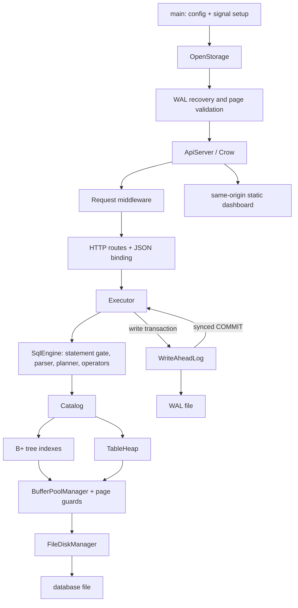

# Architecture

This document describes the current implementation rather than an intended
future design. Build targets and source locations are in the root
[CMakeLists.txt](../CMakeLists.txt).

## Runtime shape

The service entry point configures logging and signal handling, parses one
validated environment-backed `Config`, opens the disk and WAL, replays recovery,
validates the database header, and only then constructs the API server. Source:
[main.cpp](../src/main.cpp), [config.cpp](../src/config.cpp),
[server.cpp](../src/api/server.cpp), and [routes.cpp](../src/api/routes.cpp).
The dashboard assets are served by the same Crow process; there is no second
runtime service or frontend build.

## Storage and query path

- `FileDiskManager` reads and writes fixed 4096-byte pages and validates their
  explicit-endian headers and CRC32C checksums.
- `BufferPoolManager` maps page IDs to frames, uses pin-owning page guards,
  coordinates loading and replacement, and performs disk I/O outside its page
  table mutex. `clock` and `lruk` replacement policies are selectable.
- `TableHeap` stores schema-encoded tuples in slotted pages. The catalog and
  each index root are persisted in the database; the SQL catalog currently
  fits on one page.
- `BPlusTree` handles point/range access for supported key types. SQL plans
  use sequential scans where index ordering or ranges are unsupported.
- `Executor` is the public statement boundary. `SqlEngine` in
  [sql_executor.cpp](../src/sql_executor.cpp) contains the v1 planner and
  Volcano-style operators (scan, filter, projection, sort, limit, aggregate,
  and DML). It is not a separate optimizer service.

The data representation is specified in [FILE_FORMAT.md](FILE_FORMAT.md).
Supported grammar is in [SQL_REFERENCE.md](SQL_REFERENCE.md). The API contract
is [openapi.yaml](openapi.yaml).

## Statement and durability path

`POST /api/v1/query` is validated and parameter-bound; the route parses the
statement to classify and authorize it, and `SqlEngine` parses it for
execution. Reads enter the statement gate in shared mode. DDL/DML/checkpoints enter exclusively;
the exclusive scope includes the complete WAL commit. A write snapshots
before-images in memory, mutates guarded pages without permitting active
transaction pages to be evicted or flushed, then appends full-page after-images
and a COMMIT record and syncs the WAL before acknowledging success. On
statement failure, before-images and allocator state are restored. The WAL is
redo-only on disk; before-images are not an on-disk undo log.

Startup replays committed images from the valid WAL prefix before binding the
HTTP listener. A checkpoint flushes dirty pages, syncs the database, then
records and syncs the checkpoint and replaces/truncates the WAL. See
[WAL_AND_RECOVERY.md](WAL_AND_RECOVERY.md) and
[adr/0001-wal-design.md](adr/0001-wal-design.md).

## Service lifecycle

On POSIX, SIGINT and SIGTERM are blocked before service threads are created and
consumed by a dedicated `sigwait` thread. Shutdown marks readiness false,
rejects new work at middleware, waits up to `DRAIN_TIMEOUT_MS` for active
requests, stops Crow, checkpoints, and syncs the database. A second signal
forces immediate exit. Crow's public stop operation also stops its I/O
services, so the listener is stopped after the request drain, not before it;
this is an implementation caveat, not a stronger accepting-socket guarantee.
Readiness/liveness details and limits are in
[CONCURRENCY.md](CONCURRENCY.md).

## Boundaries

The concurrency contract is single-writer / multiple-reader at statement
granularity, not multi-version concurrency control. The engine is not general
SQL, has no joins or multi-statement transactions, and does not provide
replication. These and other limits are itemized in
[LIMITATIONS.md](LIMITATIONS.md).
